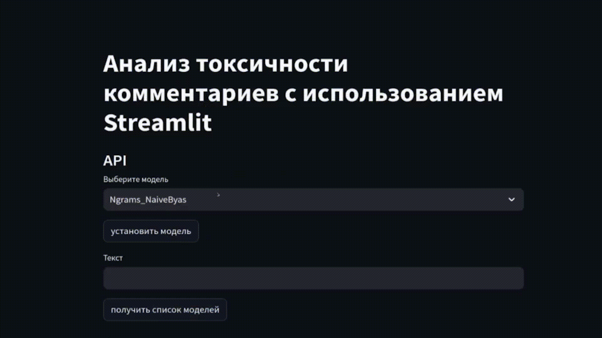
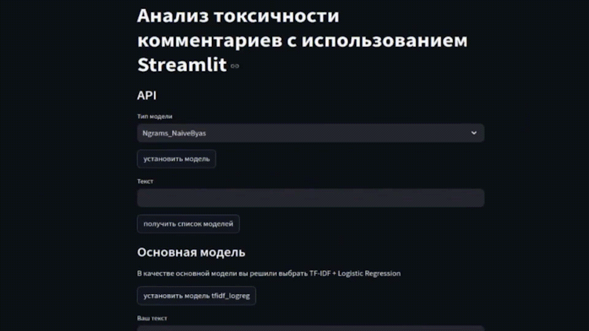

## Детекция токсичных сообщений / Классификация токсичных комментариев

Современные социальные сети и форумы часто сталкиваются с проблемой токсичных комментариев, которые могут негативно влиять на атмосферу общения и приводить к конфликтам.
Популярной стала технология в дейтинг-мессенджерах по проверке партнера на “токсичность”.
Данный проект направлен на создание системы детекции токсичных сообщений с использованием методов машинного обучения и обработки естественного языка (NLP).

### В ролях:

Арсений Карнаухов

Дмитрий Штакин

Максим Силенин

Степан Струнков

## Структура проекта

- Fast-API Сервис в services/server
- Телеграм-бот в services/bot
- Streamlit-сервис в services/streamlit

### API

API доступно по адресу `0.0.0.0:8080` с хоста.

Например, можно глянуть `http://0.0.0.0:8080/api/openapi`.

В API есть заранее загруженные модели, обученные на наших датасетах. Пользователь может обучить модели с похожим подходом, но со своим датасетом.

У API есть следующие ручки:

`fit` - запускает обучение модели в отдельном процессе. На вход принимает гиперпараметры модели.

`models` - список текущих моделей.

`set` - устанавливает активную модель (ручка сервера, а не клиента).

`predict` - предсказание загруженной модели.

### Телеграм-бот

Features бота:

- Реализует все API, кроме `fit`.
- [inline](https://core.telegram.org/bots/inline) режим.
- Кнопки.

### Streamlit-приложение

Streamlit приложение предоставляет удобный интерфейс для доступа к API, инференс основной модели, демонстрацию аналитики, кривых обучения.

Пользователь может дополнительно загрузить свой датасет заданного формата и обучить свою собственную модель.

#### Демонстрация по использованию API через streamlit

#### Демонстрация по обучению пользовательской модели через streamlit

## Использование

Если хотите поднять Телеграм-бота, то вам нужен `BOT_TOKEN` вашего Телеграм-бота и при docker-compose build & up добавить `--profile tg`. В противном случае docker-compose пропустит поднятие бота.

Из директории services без бота:
- docker-compose build
- docker-compose up

Из директории services с ботом:
- docker-compose --profile tg build
- docker-compose --profile tg up

Дальше можно воспользоваться Телеграм-ботом (если его добавляли) или сходить на сервер curl'ом/браузером, как описано в разделе API.
